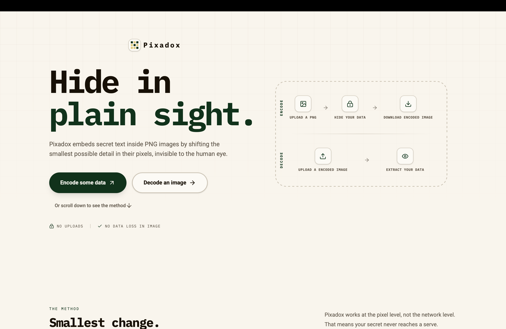
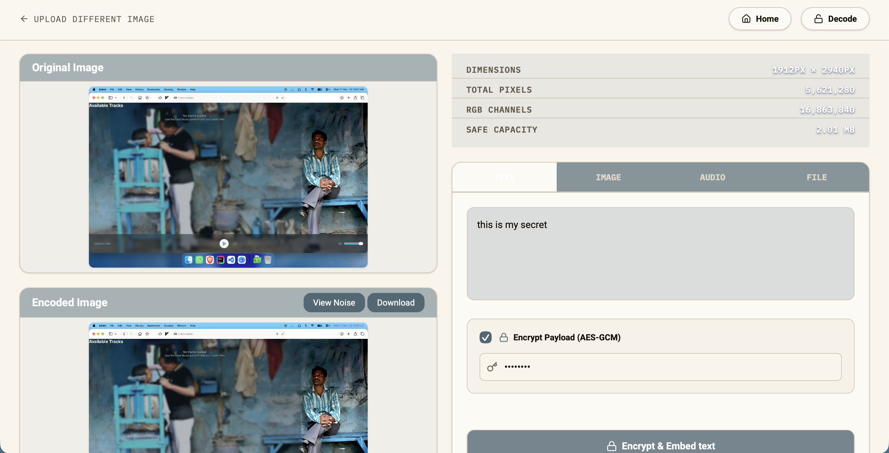
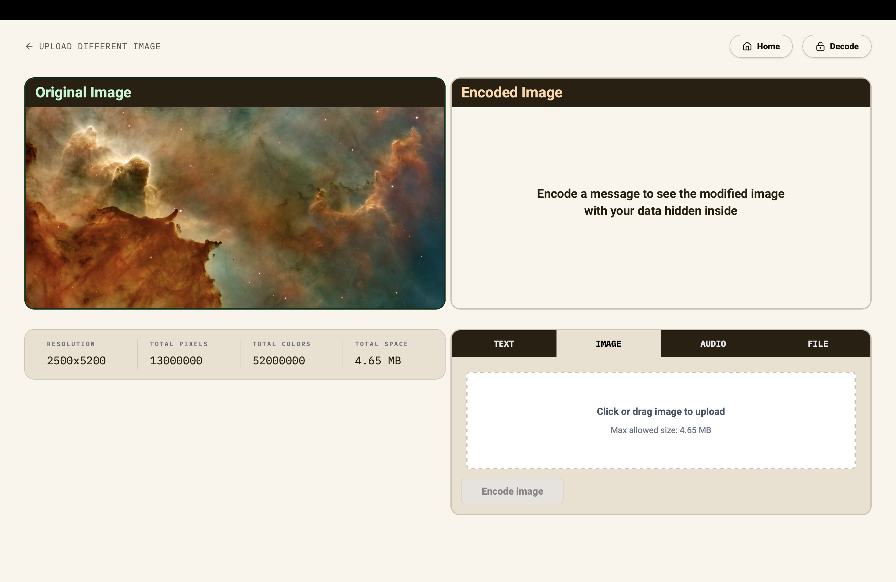

# Pixadox
- [https://pixadox.vercel.app](https://pixadox.vercel.app)
- Pixadox is a client side web application that uses steganography, to embed text and binary files like audio, image and docs
- While making the smallest possible change in the original image, undetectable to human eye

# Features
there arent much features it just does one core thing, but it does it well
### Zero Server Privacy 
- All the processing is done on the client side, ensuring that your data never leaves your device.

### Steganography
- Pixadox uses advanced steganography techniques to hide your data within images, making it virtually

### Nice UI
- well not a features, but i worked on it a lot so here it goes

# Tech Stack
- React
- Tailwind CSS
- React router
- Lucide-react
- Web Crypto API

# How to use
[https://pixadox.vercel.app](https://pixadox.vercel.app)
- Open the web application in your browser.
- If its your first time, you need to encode some data before you try to decode

# A bit inside
## Steganography
- Steganography is the practice of hiding a secret message or data inside an ordinary, non-secret file or object to avoid detection - Kaspersky IT Encyclopedia
- its not just limited to digital files, in early times similar technique was sued to hide info in letters and stuff
- in simple works is uses bit manipulation of file to store/hide some data in them, with very minimal changes to file itself
- in absolute terms output file is actually different from input, but to humans its not

## How encoding/embedding actually works
- I use canvas API to extract the raw pixel values of the image
- then i simply use the Steganography technique to embed the data into the pixel values
- i first take data input from user,which he wants to hide
- then that data is converted into binary format
- then i change the parity of color value to represent the binary data,
- odd value → 1, even value → 0, that means the color values changes by at most 1 and even in this case statically only 50% of times i will need to change

### Encryption
- no you can encrypt the message that you store in the image
- a password is used to generate a cipher of your message then this cipher in encoded in the image

## Decoding
- Again i read the raw pixel values of the image which is to be decoded
- then according to the rules that i use to encode i extract a binary string out of the images color values which is based on their parity as mentioned in enode step
- then i convert that binary string into text and return it to user

### for encrypted encodings
- a header flag in present to indicate whether the message is encrypted or not
- if flag is true then then three things are extracted from the body of the image --> Salt + IV + Cipher 
- then user is prompted for a possword and the passowrd + salt = IV is used to verify and decipher the inoformation

## Storing data other than text;
- so to do this i attach some metadata along with the users data
- like, size of data, type of data and a unique marker `%PI#XL%` to recognize if the image was encoded by pixadox or not, so that i can decode it properly
- - marker takes 56 bits, data size take 32 bits, and data type takes 8 bits, 8 bits for flagging the password protection,  so total 104 bits of metadata is added to the image
- and to reconstruct the data safely i use `Unit8ClampedArray`

# Run locally
- clone the repo
- `cd pixadox`
- `npm install`
- `npm run dev`
- check on localhost:5173

### Used some tailwind UI snippets from flowbite.com

# Future
- 